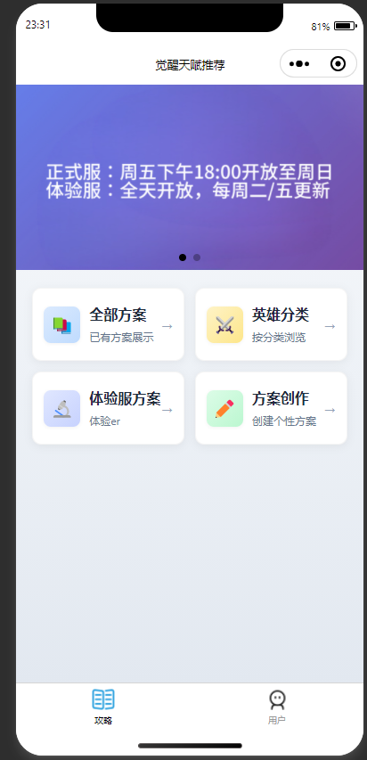
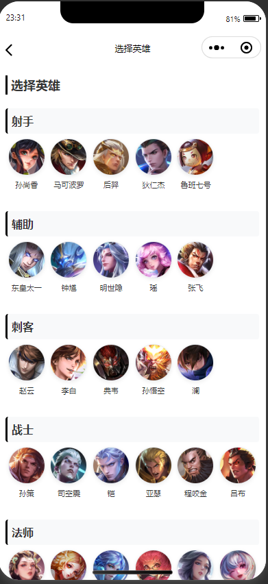
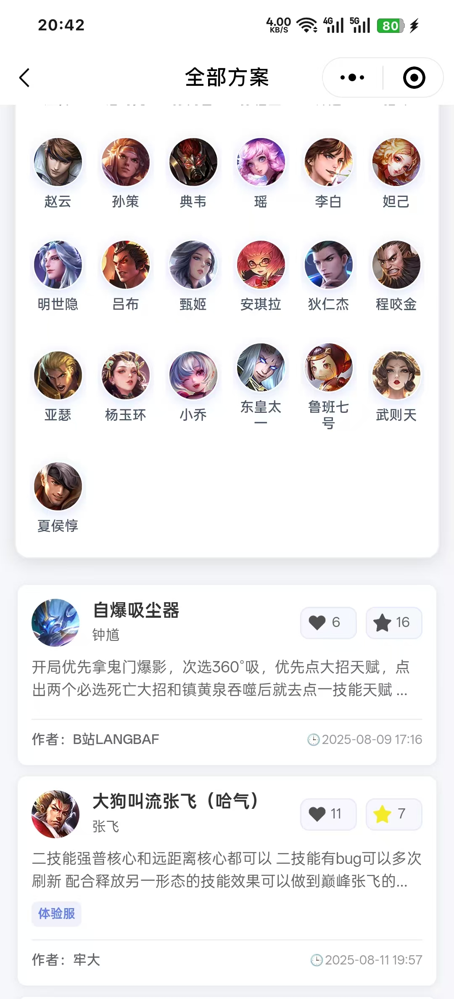
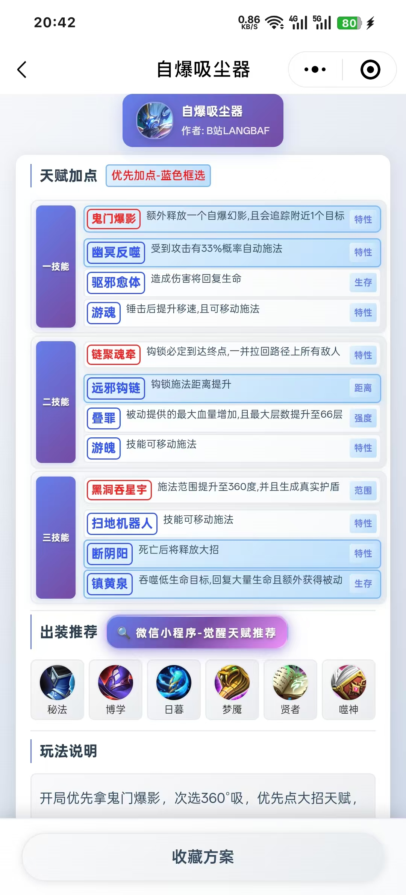
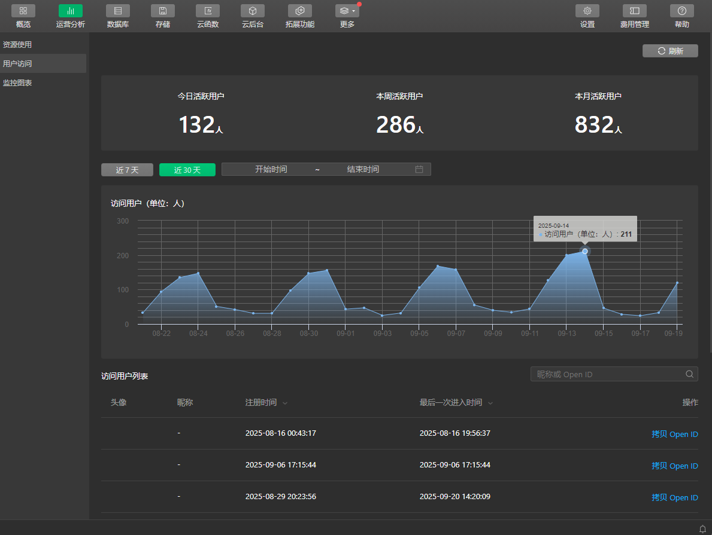

# 觉醒天赋推荐 · 微信小程序

面向《王者荣耀》觉醒之战玩家的天赋与出装方案工具，支持按英雄查找攻略、查看天赋搭配、收藏与点赞，以及方案创作、审核和发布。

**个人独立项目 · Cursor 辅助开发 · 2025 年 9 月结束运营**

[项目复盘与运营记录](https://yyyt03.github.io/blog/awakening-mini-program/) · [作者主页](https://yyyt03.github.io/)

## 我的职责

独立完成需求梳理、页面设计与开发、云函数和数据交互、测试、微信小程序发布及日常内容维护。使用 Cursor 辅助编码，负责明确功能逻辑、检查实现，并根据实际使用反馈持续修复问题。

项目围绕一条完整使用路径展开：**查找英雄 → 浏览方案 → 查看天赋与出装 → 收藏或点赞 → 创建方案 → 审核发布**。

## 产品截图

<table>
  <tr>
    <td align="center"><a href="assets/screenshots/home.png"></a><br>首页入口</td>
    <td align="center"><a href="assets/screenshots/heroes.png"></a><br>英雄分类</td>
  </tr>
  <tr>
    <td align="center"><a href="assets/screenshots/plans.jpg"></a><br>方案列表</td>
    <td align="center"><a href="assets/screenshots/detail.jpg"></a><br>方案详情</td>
  </tr>
</table>

[查看用户中心与方案审核长截图](assets/screenshots/moderation.jpg)。点击图片可查看原图；方案中的攻略作者署名予以保留。

## 核心功能

| 模块 | 实现内容 |
| --- | --- |
| 攻略浏览 | 全部方案、英雄职业分类、正式服与体验服方案 |
| 方案详情 | 三个技能的天赋选择、优先加点、推荐出装与玩法说明 |
| 用户互动 | 点赞、收藏、个人收藏列表，跨页面同步交互状态 |
| 方案创作 | 填写英雄、天赋、装备和玩法，提交后进入待审核状态 |
| 内容管理 | 方案预览与编辑、通过发布、退回原因、下架及删除 |
| 个人中心 | 查看自己的方案、收藏方案与管理入口 |

## 技术实现

- **前端**：微信原生小程序，TypeScript、WXML、WXSS；共 10 个业务页面。
- **后端与存储**：微信云开发、15 个云函数、微信云数据库；通过 `wx-server-sdk` 访问云端数据。
- **内容结构化**：以英雄和方案为核心，组织天赋、装备、玩法说明、作者、状态及互动计数。
- **投稿与审核**：创建方案时保存为 `pending`，通过状态更新完成发布、退回和下架。
- **状态同步**：统一通知收藏与点赞变化，结合本地时间戳、页面监听和缓存更新，处理返回页面后的状态变化。
- **列表与兼容处理**：分页数据按方案 ID 去重，兼容不同日期表示及 iOS 日期解析。

## 历史运营结果

玩法开放期间，周末稳定有 **100+ 活跃用户**。下架前保存的云开发运营截图记录如下：

| 指标 | 历史记录 |
| --- | ---: |
| 当日活跃用户 | 132 人 |
| 当周活跃用户 | 286 人 |
| 当月活跃用户 | 832 人 |
| 2025-09-14 访问用户 | 211 人 |



2025 年 9 月，研一开学后因课程和学习安排，停止维护并下架小程序。此次实践完整覆盖了需求、开发、上线和真实用户运营。

## 源码与目录

当前保留的业务代码最后提交于 **2025-08-16**（`de52ce0`）；部分产品截图来自后续运营阶段。本仓库用于保存历史实现与展示项目经历。

```text
cloudfunctions/       云函数及其独立依赖
miniprogram/
  pages/              业务页面
  data/               英雄本地数据
  utils/              数据查询、缓存、交互同步等工具
scripts/              依赖版本检查与数据维护脚本
assets/screenshots/   项目展示截图
project.config.json   微信开发者工具项目配置
```

## 本地查看与运行

### 1. 获取代码与依赖

准备 Node.js、npm 和微信开发者工具，然后在 PowerShell 中运行：

```powershell
git clone https://github.com/yyyt03/timiTest1.git
Set-Location timiTest1
npm ci
npm run install:cloud
```

### 2. 配置自己的微信云开发环境

1. 在微信开发者工具中导入仓库根目录，配置自己的小程序 AppID。
2. 创建云开发环境，替换 `miniprogram/app.ts`、`miniprogram/utils/config.ts` 及各云函数等位置引用的历史环境标识。
3. 按代码中的集合访问准备数据库结构和初始数据，重新上传所需英雄、装备与图标资源，并更新历史 `cloud://` 路径。
4. 在开发者工具中右键各云函数，选择“上传并部署：云端安装依赖”，再编译查看页面。

仓库保存的是小程序源码和展示截图；原运营环境的云数据库内容与云存储资源需要在新环境中自行准备。本次整理只发布历史作品，不重新部署原服务。

### 3. 辅助检查

```powershell
npm run check:versions
```

此命令检查云函数依赖版本一致性。页面交互与云端流程在微信开发者工具中验证；`npm run build` 和 `npm run deploy:cloud` 仅输出操作提示。
